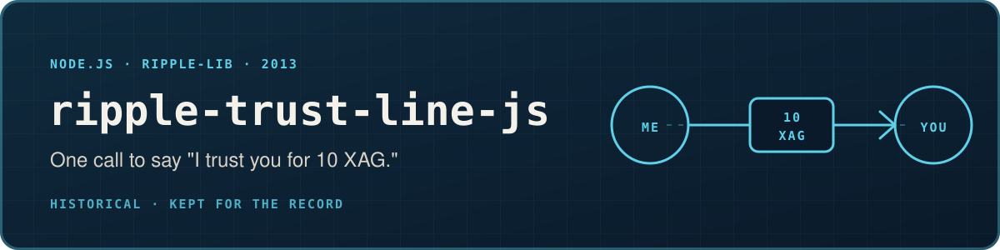
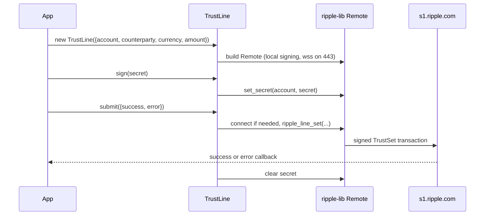

<p align="center"></p>

  

> [!NOTE]
> **Historical project (December 2013).** Written against the early `ripple-lib` `Remote` API, which has since been replaced, and not maintained since. It has no `package.json` and no tests, and I have not run it against the live network. Kept for the record. See [docs/STATUS.md](docs/STATUS.md).

# ripple-trust-line-js

A small Node.js wrapper that makes it simple to set a **trust line** on the Ripple network.

On Ripple you cannot hold someone else's IOUs (say, silver, `XAG`) until you tell the ledger you trust them for some amount. Doing that by hand means understanding the trust-line system, connecting to a remote server, and building the right transaction. My goal was to hide all of that behind an interface for the **90% use case**: this account trusts that counterparty for this much of this currency.

## Features

- One constructor, one `sign`, one `submit`
- Connects to the public `s1.ripple.com` server over secure WebSocket (port 443)
- Signs locally (`local_signing`), so the secret key never leaves your machine
- The secret is cleared after the transaction is submitted, so one signing call serves one trust-line transaction
- Can list an account's existing trust lines (see the caveat in [docs/STATUS.md](docs/STATUS.md))

## Install

There is no `package.json` and nothing was ever published to npm. The only dependency is [`ripple-lib`](https://github.com/ripple/ripple-lib) from 2013, whose old `Remote` API this code uses.

    git clone https://github.com/stevenzeiler/ripple-trust-line-js.git
    cd ripple-trust-line-js
    npm install ripple-lib   # pick a 2013-2014 version; modern ripple-lib has no Remote API

## Usage

The original example had a missing comma; this is the corrected version.

```js
var TrustLine = require('./trust_line.js');

var trustLine = new TrustLine({
  account: 'rHKueQebtVU9cEamhBbMV8AEViqKjXcBcB',        // who is extending trust
  counterparty: 'r4EwBWxrx5HxYRyisfGzMto3AT8FZiYdWk',   // who they trust
  currency: 'XAG',                                      // silver, as in my fiat gem
  amount: 10
});

trustLine.sign(process.env.RIPPLE_SECRET_KEY).submit({
  success: console.log,
  error: console.log
});
```

The addresses are public Ripple account addresses used as examples. The secret comes from the `RIPPLE_SECRET_KEY` environment variable and should never be written into source.

## How it works



## Project layout

```
trust_line.js     the whole library: the TrustLine constructor and its methods
README.md         this file
docs/STATUS.md    what works, what is broken, what is unknown
docs/readme/      the banner image
AGENTS.md         notes for AI agents (CLAUDE.md points at it)
```

## History

- **2013-12-23, 14:53:** `TrustLine` abstraction and the first README.
- **2013-12-23, 15:07:** README rationale, then "only allow secret to be used for one trust line transaction". Four commits in about 15 minutes, and that was all.
- Written during my first weeks working on Ripple tooling; the `XAG` example echoes my earlier [fiat](https://github.com/stevenzeiler/fiat) gem, which tracked precious-metal prices.

---

Status and caveats: [docs/STATUS.md](docs/STATUS.md) · Agent notes: [AGENTS.md](AGENTS.md)
